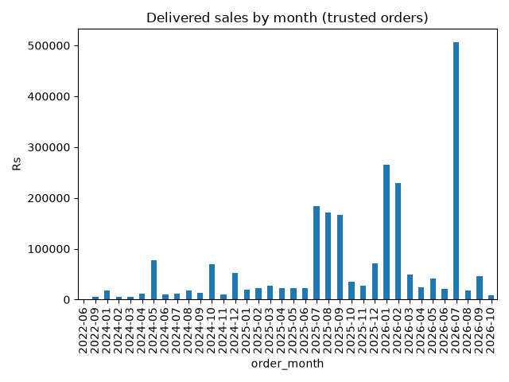

# QuickMart Analytics Dashboard

A premium single-page BI dashboard for the QuickMart capstone, served by FastAPI.
Every figure on the page is read from a committed file in `../data/` or `../outputs/`
at request time — nothing is hard-coded and nothing is invented.



---

## Install & run

From **this folder** (`dashboard/`):

```powershell
pip install -r requirements.txt
uvicorn main:app --reload
```

Then open <http://localhost:8000>.

> The app resolves its data folders relative to its own location, so running
> `uvicorn main:app` from `dashboard/` is the supported entry point.
> From the project root you can equally run
> `uvicorn dashboard.main:app --reload`.

Requirements are pinned (`fastapi==0.142.2`, `uvicorn==0.54.0`, `pandas==3.0.6`,
`numpy==2.5.3`). No Node.js, no build step, CORS is off by default.

---

## What the page shows

| Section | Content |
|---|---|
| Overview | KPI cards (delivered sales, orders, AOV, trusted orders, rejected rows, commission leakage) with count-up animation; validation strip; data-freshness list |
| Sales | Monthly delivered sales (styled after `charts/monthly_sales.png`), city and category cuts, all driven by the filter bar |
| Customers | Top-10 customers (masked `#1…#10`), sortable/searchable table with CSV download, signup-cohort chart |
| Payments | Payment-mix doughnut + table (population note: all statuses) |
| Delivery | Weighted average days, impossible/negative/over-30/missing counts, per-city charts, city × category table |
| Data quality | Quality scorecards, rule failures + warnings chart, city × month issue heatmap, most-missing columns, rule catalogue and issue registry tables |
| Trust & commission | Orders waterfall (raw → clean → lenient/strict/rejected), dedup headline, commission before/after by city, trust KPIs |
| Questions | All 125 capstone data questions with status, headline answer, segment/status/search filters and a saved-SQL-result viewer |
| Capstone answers | The five business problems with approach, decision, alternative, effect, numbers, code and links to the supporting panels; verified insights with figure provenance |

Interactive: month-range, city and category filters re-query the API; tables sort by
clicking headers and are searchable; every table has a **Download CSV** button.
Dark/light theme toggle, keyboard focus styles, ARIA labels and
`prefers-reduced-motion` support are built in. Chart.js is served locally from
`/static/vendor/` — the page works fully offline.

---

## API endpoints

All endpoints return strict JSON (`NaN`/`Infinity` -> `null`); see live schema at `/docs`.

| Endpoint | Description |
|---|---|
| `GET /api/health` | Service heartbeat |
| `GET /api/meta` | File freshness (mtime), row counts, filter domain (months/cities/categories) |
| `GET /api/kpis` | Headline KPIs; filters: `month_from`, `month_to`, `city`, `category` |
| `GET /api/monthly-sales` | Delivered sales by month; same filters |
| `GET /api/sales-cuts?dim=city\|category` | Sales grouped by city or category with share % |
| `GET /api/payment-mix` | Payment method mix; filters: `month_from`, `month_to`, `city` |
| `GET /api/top-customers?n=10&by=value\|orders` | Masked top customers (dense ranks, ties flagged) |
| `GET /api/cohort` | Signup-month × order-month cohort value |
| `GET /api/delivery` | Delivery days by city × category, anomaly counts |
| `GET /api/quality/scorecard` | Per-table quality scores |
| `GET /api/quality/rules` | Rule failures/warnings joined to rule metadata |
| `GET /api/quality/heatmap` | % of orders with ≥1 issue per city × month |
| `GET /api/quality/profile` | Column profiler (missing %, distinct counts) |
| `GET /api/quality/issues` | Issue registry |
| `GET /api/duplicates` | Dedup headline, masked registry, commission effect |
| `GET /api/trust` | Waterfall raw 6,103 → clean 6,000 → lenient 522 / strict 115 / rejected 5,478 |
| `GET /api/commission` | Commission before/after overall and by city/payment/status/month |
| `GET /api/manifest` | Criteria, validations, provenance hashes, rubric, headline payload |
| `GET /api/questions` | 125 data questions; filters: `segment`, `status`, `q`, `limit` |
| `GET /api/capstone` | The five business problems + verified insights |
| `GET /api/sql-list` | Saved SQL result ids (`q50`…`q125`) |
| `GET /api/sql-file/{qid}` | Saved SQL result text, with customer ids masked (`C0123` → `C-ab12cd`) |

---

## Folder structure

```
dashboard/
  main.py                     FastAPI app (all endpoints above)
  requirements.txt            pinned dependencies
  NOTES.md                    findings, question→panel→endpoint mapping, n/a notes
  README.md                   this file
  data.json                   pipeline payload (criteria, questions, insights)
  criteria_cache.json         criteria cache kept for the pipeline
  templates/
    index.html                the dashboard shell (no inline JS)
  static/
    styles.css                theme + layout (light/dark)
    app.js                    data loading, filters, tables, CSV, questions, capstone
    charts.js                 all Chart.js builders (theme-aware)
    vendor/
      chart.umd.min.js        Chart.js 4.4.1, vendored for offline use
  tests/
    smoke_api.py              all endpoints via TestClient (no server needed)
    live_check.py             live server check incl. privacy scan and KPI cross-check
  archive/
    legacy_index.html         previous machine-generated page (superseded)
    legacy_charts.js          previous chart snippet (superseded)
```

Project data folders read by the app: `../data/` (marts, quality, commission,
profiles), `../outputs/` (lenient/strict/rejected populations and rule log),
`../charts/` (reference PNG served at `/media/charts/monthly_sales.png`).

---

## Privacy

- Customer identifiers are masked everywhere: dense-rank labels (`#1…#10`) in
  customer views, SHA-1 short hashes (`id-3f9a2c11`) in the duplicates registry,
  and consistent label mapping (`C0123` → `C-ab12cd`) inside saved SQL results.
- Emails and phone-like strings are scrubbed from any free text that passes
  through the API. No names, emails or notes are ever served.

## Verification (last run)

- All 28 API endpoints return `200` with valid JSON and no `NaN`/`Infinity`.
- KPI cross-checks against source files:
  - delivered sales = `Rs 2,309,394.00` = `data/sales_datamart.csv` total = `report_validation.csv`,
  - delivered orders = `799`, AOV = `Rs 2,890.36` (2,309,394.00 ÷ 799),
  - lenient trusted = `522` rows / `Rs 455,160.75`; strict = `115` / `Rs 79,738.50`;
  - commission leakage = `Rs 7,756.28`; waterfall reconciles 6,000 = 522 + 5,478.
- `templates/index.html` contains no inline JavaScript; `node --check` passes on
  both `static/app.js` and `static/charts.js`; the HTML is tag-balanced with a
  UTF-8 charset and ASCII-only source.

See `NOTES.md` for the full mapping of capstone questions to panels and endpoints,
and for the list of figures shown as **n/a** with the reason why.

Repeatable checks (from the dashboard folder):

```powershell
python tests/smoke_api.py     # every endpoint through TestClient, no server needed
python tests/live_check.py    # live server: assets, JSON validity, privacy scan, KPI cross-check
```
